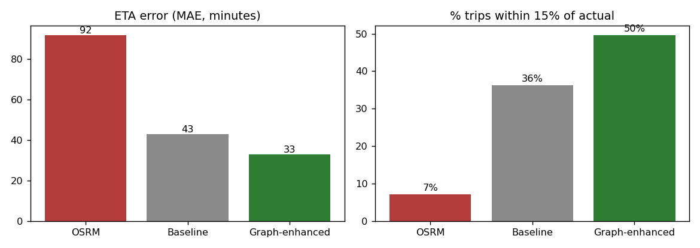
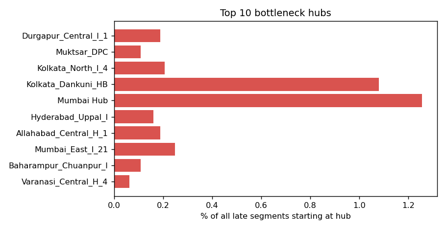
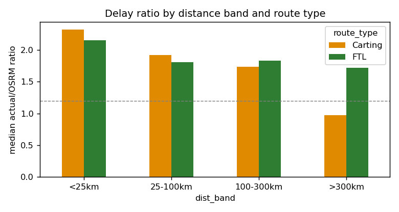
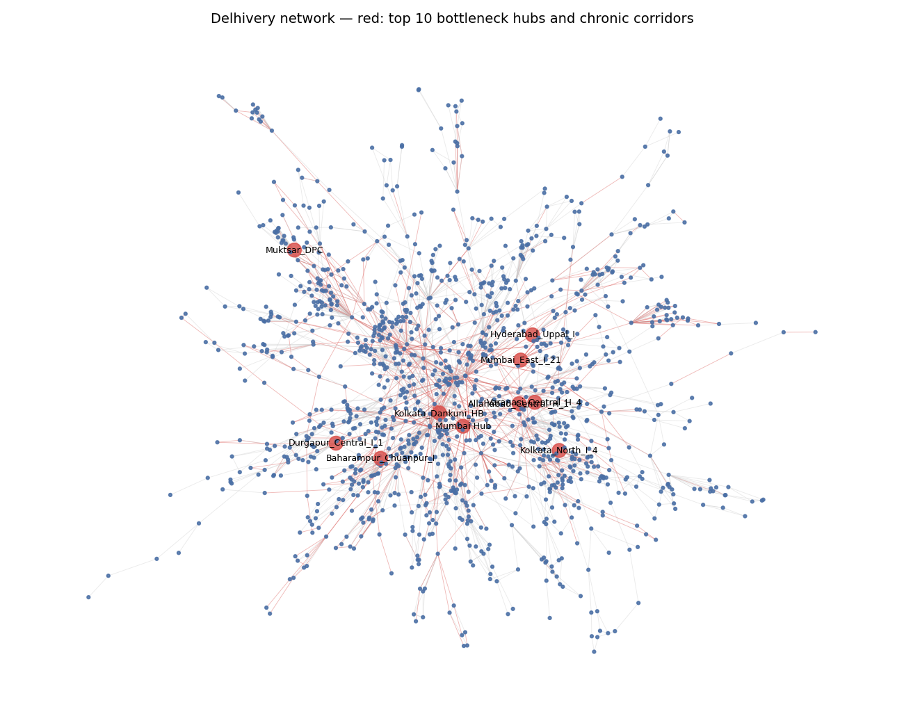

# Optimizing Delivery ETAs with Graph-Based Network Intelligence

Delhivery's current ETA engine (OSRM) underestimates transit time almost everywhere: the median actual segment time is **1.9× the OSRM estimate**, and only **7%** of trips land within 15% of the promised time. This project models the Delhivery logistics network as a directed graph and uses it to:

1. build a **graph-enhanced ETA model** that cuts error by 64% vs. OSRM, and
2. run a **structural audit** to find the hubs, corridors and route-type choices that cause most delays.

The findings and recommended operational interventions are summarized in [`strategy_memo.pdf`](strategy_memo.pdf).

## Key results

On a held-out test set of 7,388 segments:

| Model | MAE (min) | Within 15% of actual |
|---|---|---|
| OSRM (current) | 91.8 | 7% |
| Baseline GBM (trip features only) | 42.8 | 36% |
| **Graph-enhanced GBM** (corridor history + centrality + node2vec) | **32.8** | **50%** |



- **Delay is a property of network position.** A corridor's historical delay ratio is the most informative graph feature, so delay can be predicted and promised against.
- **Bottlenecks are concentrated.** The top 3 hubs (Gurgaon_Bilaspur, Bhiwandi_Mankoli, Bangalore_Nelamangala) originate ~10% of all late segments network-wide. These delays cluster in three metros: NCR, Mumbai and Bengaluru.
- **FTL is not always faster.** FTL wins under 100 km, but Carting beats FTL beyond 300 km (0.97× vs 1.72× median delay ratio).

| Bottleneck hubs | FTL vs Carting |
|---|---|
|  |  |



## Approach

- **Unit of analysis:** the raw data has one row per scan checkpoint (144,867 rows). Rows are aggregated by `(trip, source, destination)` into 26,368 facility-to-facility **segments**.
- **Core metric:** `delay_ratio = actual_time / osrm_time`. A segment counts as **late** when the ratio exceeds 1.2, the 20% SLA-breach threshold.
- **Graph:** 1,657 facilities are nodes and 2,777 corridors are edges. Each edge is weighted by the corridor's median delay ratio.
- **Bottleneck score:** combines delay-weighted betweenness centrality (40%), median outbound delay (30%) and trip volume (30%).
- **ETA model:** gradient boosting on `log(1 + actual_time)`. The graph model adds corridor history, hub centrality, degree, PageRank and 16-dimensional node2vec embeddings for the source and destination.
- **Leakage control:** the dataset's own train/test split is kept. Every graph statistic is computed from training segments only, and unseen corridors fall back to the global training median.

## Repository structure

```
├── data_prep.py          # scan rows -> cleaned segments with delay features
├── network_analysis.py   # builds the graph, scores bottleneck hubs, audits corridors
├── eta_model.py          # OSRM vs baseline vs graph-enhanced ETA benchmark
├── route_framework.py    # FTL/Carting decision framework + all figures
├── strategy_memo.pdf     # findings and recommendations for Network Operations
├── figures/              # charts used in the memo and README
└── outputs/
    ├── model_benchmark.csv       # MAE and within-15% accuracy per model
    ├── feature_importance.csv    # graph model feature importances
    ├── node_metrics.csv          # per-facility centrality and bottleneck score
    ├── corridor_audit.csv        # per-corridor delay stats, chronic flag
    ├── ftl_carting_tradeoff.csv  # delay by distance band and route type
    └── route_type_framework.csv  # recommended route type per distance × time × centrality cell
```

## Running it

**Requirements:** Python 3.9+ and the following packages:

```bash
pip install pandas numpy networkx node2vec scikit-learn matplotlib
```

Put the Delhivery dataset in the project root as `delivery_data.csv`; it is not included in this repository. Then run the scripts in order:

```bash
python data_prep.py          # writes outputs/segments.pkl
python network_analysis.py   # writes node_metrics.csv, corridor_audit.csv
python eta_model.py          # writes model_benchmark.csv, feature_importance.csv
python route_framework.py    # writes framework CSVs and figures/
```

## Limitations

The data covers September–October 2018 only, so seasonal volume spikes are untested.
